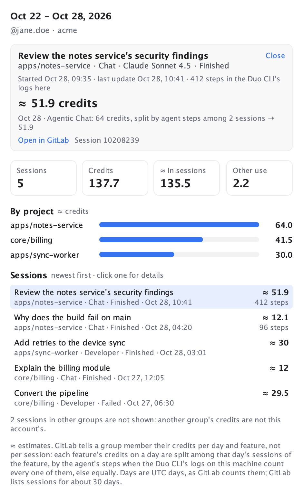

<div align="center">

<picture>
  <source media="(prefers-color-scheme: dark)" srcset="docs/images/logo-dark.svg">
  
</picture>

# Duo Watchdog

**Keep an eye on your GitLab Duo credits without leaving the editor.**

A plugin for **IntelliJ IDEA** (and other JetBrains IDEs) and an extension for **VS Code** that track **your own**
GitLab Credits usage for the current billing period, forecast where the month will end, and warn you before you hit your limit.


</div>

<p align="center">
  
  &nbsp;&nbsp;
  
</p>

---

## What's new in 0.7.0

- **Updates from the editor**: Duo Watchdog asks GitHub for its latest release when the IDE starts and then once a
  day, says when a newer one is out, and **Update** downloads and installs it: IntelliJ IDEA puts it in place on its
  next restart (**Restart Now**), VS Code on the next reload. Also *Tools → Duo Watchdog: Check for Updates…* and
  **Duo Watchdog: Check for Updates**, and an **Update to x.y.z** button on the dashboard's toolbar. See
  [Updates](#updates).
- The Duo CLI's tool approval reads **Manual** or **Auto** (`--dangerously-skip-permissions`).
- Sessions' **By project** puts each project on a line of its own over its bar, cut from the front so the project's
  own name shows (`…/mobile-android`), with the whole path on hover.

## What's new in 0.6.0

- **Duo CLI quick actions on Usage**: start the GitLab Duo CLI in a new terminal in the project, as `duo` or
  `glab duo cli`, asking before each tool or auto-approving them all, from two drop-downs; **New session** starts it,
  **Doctor** then types `/doctor`, and **quick commands** of your own type theirs: **+** builds one, the command first
  (`/ab-testing`), then its button's name (`AB Testing`). See [Duo CLI quick actions](#duo-cli-quick-actions).

## What's new in 0.5.0

- **0.5.3**: every time shown says its day and its zone, on your computer's clock: `Updated today 11:45 UTC+2`, and
  the session's `Started today 10:00 UTC+2, 34m 17s, quiet since today 10:34 UTC+2`, with `yesterday` or the date for
  an older one.
- **0.5.2**: the Duo CLI session always shows its **≈ $**: a session on the group's default model, whose log does not
  name the model, is priced as the **Group default model** in Settings (Sonnet 4.5 unless you pick another).
- **0.5.1**: the session of the interactive Duo CLI (9.30) counts its **round trips**, one per prompt, and shows even
  before its first tool call; a session on the group's default model says **Group default**; a project in WSL has its
  Duo CLI runs followed once, not twice.
- **The Duo CLI session, live**: while `duo` runs a session, a small status bar item beside the credits shows how long
  it has run, its round trips (prompts you sent), its steps (model calls) and its ≈ credits, each step at its model's
  credits per call: `12m 4s · 5 round trips · 42 steps · ≈ $38.2`, updated within seconds of each step. Its mini meter
  fills toward a recommended most of round trips per session (20 unless you set another), amber from 80% of it and
  red at it. The Sessions tab starts with the same session. Read from the CLI's own log; no tokens are shown, since
  GitLab bills per model call. See [Sessions](#sessions).
- **Token rotation**: a week before an account's token expires, GitLab replaces it with a new one that lives as long,
  saved and handed to glab, with **Copy the New Token** for wherever else you use it. On by default. Each account says
  when its token rotates, or why it won't. See [Token rotation](#token-rotation).
- Released under the [MIT License](#license).

## What's new in 0.4.0

- **Several accounts**, one token each, in IntelliJ IDEA and VS Code. An account is one GitLab user on one GitLab:
  when you add a token, GitLab says whose it is, and a token for an account already listed replaces its token,
  keeping its group and limit. See [Several accounts](#several-accounts).
- **Accounts in Settings** (IntelliJ IDEA): credits left, the token and its expiry date for each, most credits left
  first, with **All / Has credits / Expired** filters and a search. A saved token shows as dots in a locked field, a
  missing one as an empty field. VS Code has the same list in **Duo Watchdog: Accounts**.
- **Add Token** says what OK will do: add an account, replace a token, or add an account whose usage can't be
  tracked (no `ai_features` scope) instead of failing.
- An **account switcher** in the tool window and the dashboard; the status bar follows it, with a dot (a bell in
  VS Code) when another account needs a look, and the tooltip lists every account.
- **Popups** for a token that expires within 3 days and a token GitLab turns down; in IntelliJ IDEA these, the last
  alert threshold, the limit and a block stay on screen until closed.
- **glab and the GitLab Duo CLI** (optional, off by default): an account can hand its token to glab, and so to the
  Duo CLI. See [glab and the GitLab Duo CLI](#glab-and-the-gitlab-duo-cli-optional).
- A **Statistics** tab next to the dashboard: your last 3, 6 or 12 months by month and by feature, with what GitLab did
  not bill, for one account or all of them. See [Statistics](#statistics).
- A **Sessions** tab: your Agent Platform sessions over the days you pick, each with its credits, estimated, and the
  projects that cost most. Look a session up by its ID or link, or show your last one. See [Sessions](#sessions).
- **What's New**: after an update, a window shows what the version brings, with pictures (*Help → What's New in Duo
  Watchdog* in IntelliJ IDEA, **Duo Watchdog: What's New** in VS Code).
- Upgrading from 0.3.0 moves the saved token to its account, with its group, limit and last alert.

## Contents

- [What's new in 0.7.0](#whats-new-in-070)
- [What's new in 0.6.0](#whats-new-in-060)
- [What's new in 0.5.0](#whats-new-in-050)
- [What's new in 0.4.0](#whats-new-in-040)
- [Features](#features)
- [VS Code](#vs-code)
- [How it works](#how-it-works)
- [Requirements](#requirements)
- [Installation](#installation)
- [Configuration](#configuration)
- [Building from source](#building-from-source)
- [Project structure](#project-structure)
- [Troubleshooting](#troubleshooting)
- [License](#license)

## Features

### Status bar meter

The status bar shows a doberman icon, a small meter and `$21.5 / 300`: credits used out of your limit
(GitLab's list price is $1 per credit).

- **Normal:** neutral colors while usage is below your lowest alert threshold.
- **Warning:** amber with a warning icon once usage reaches the lowest threshold.
- **Blocked:** red `Blocked · $300 / 300` when GitLab blocks Duo because you hit the cap.

The tooltip shows the remaining credits, the month-end forecast and when the data was last updated.
Clicking the meter opens the dashboard.

**While `duo` runs a session**, a second, small item beside it shows the session:
`12m 4s · 5 round trips · 42 steps · ≈ $38.2`. That is how long it has run, ticking every second while the CLI writes
its log and stopping once the log has been quiet for a minute; then the prompts you sent, the model calls, and the
≈ credits (see [Sessions](#sessions)). Its mini meter fills with round trips toward the **recommended most per
session** (20 unless you set another, 0 for none): neutral, then **amber** from 80% of it, **red** at it. The tooltip
adds the model, when the session started and `17 of 20 recommended round trips`; a click opens Sessions. The item is
hidden when no session runs.

### Dashboard tool window


- A toolbar with **Refresh** and **Settings**, plus `@user · group · Updated today 14:05 UTC+2`
- A **Duo CLI** row under it: the CLI and the tool approval to start it with, **New Session**, **Doctor** and your
  quick commands, and **+** to add one (see [Duo CLI quick actions](#duo-cli-quick-actions))
- The headline: credits used, an **Active** / **Blocked** status and the period with the current day
- A usage bar with a dashed forecast marker and ticks at each alert threshold
- Tiles for **Left**, **Forecast**, **Pace** (credits per day) and **Spent today**: four abreast in a wide tool window,
  two by two in a narrow one
- A **daily usage** chart covering the whole month, with the rest of the month shaded, a "today" line and tooltips on the bars
- A **by feature** breakdown (Developer Flow, Code Review Flow, …)
- **Shift+Esc** hides it and **Esc** goes back to the editor, as in the IDE's own tool windows

<br clear="right">

### Duo CLI quick actions

Usage starts the [GitLab Duo CLI](https://docs.gitlab.com/user/gitlab_duo_cli/) for you, in a new terminal in the
project (IntelliJ IDEA's Terminal, VS Code's integrated terminal). Two drop-downs say how, and are remembered:

| Drop-down | Choices |
|---|---|
| **The CLI** | `duo`, or `glab duo cli`, which hands its arguments to `duo` |
| **Tool approval** | **Manual**: the CLI asks before each tool (its default), or **Auto**: `--dangerously-skip-permissions`, the CLI runs every tool without asking |

| Button | Does |
|---|---|
| **New session** | Runs the CLI, e.g. `duo --dangerously-skip-permissions` |
| **Doctor** | Runs it, then types `/doctor` at its prompt: the CLI's diagnostics |
| **Your quick commands** | Run it, then type their command at its prompt: a slash command of your own such as `/ab-testing`, or a prompt |

**Building a quick command.** Click **+** (VS Code: **+ Add command**). Type what it should type at the CLI's
prompt, such as `/ab-testing`, then its button's name, such as `AB Testing`: the name starts as one made from the
command (`Ab Testing`) for you to change. In IntelliJ IDEA, **✎** opens Settings, where **Duo CLI quick commands**
lists them to change, move up or down, or remove; in VS Code, **Edit…** does the same in a list. Up to twelve, each
name once; a command is one line.

A command is typed only once the CLI has started: Duo Watchdog waits for the new log the CLI writes (the same
logs the [live session](#whats-new-in-050) is read from), then a moment for its prompt. If no log comes within a minute
nothing is typed, so a CLI that did not start never gets the command typed into your shell; a notice says to type it
yourself. The CLI's Build, Plan and Auto modes have no command-line flag: switch them with Tab in the CLI. In IntelliJ
IDEA the buttons need the bundled Terminal plugin, which is on unless you turned it off. In VS Code they are also
commands: **Duo Watchdog: New Duo CLI Session**, **Duo CLI Doctor**, **Run a Duo CLI Quick Command…**, **Add a Duo
CLI Quick Command…** and **Edit Duo CLI Quick Commands…**.

### Statistics


The tool window's **Statistics** tab shows the last **3, 6 or 12 months** (3 until you pick more) of the chosen account,
or of **All Accounts** added up (features merged by name):

- **This month**, **Last month**, the monthly **Average** (from the first month with any use) and the total
- A bar a month, split by the five costliest features of the range; the rest is folded into *Other*. Hover a bar for
  the month's figures.
- Every month as a row, newest first, with its costliest feature and what GitLab did not bill
- The features over the range
- **Not billed**: credits GitLab counted as promotional or beta. GitLab's own usage page includes them in its total,
  so it can show more than Duo Watchdog's billed figures.

It reads `creditsUsage` a month at a time, which a group member may read about themselves: per day and per feature.
Per project, per model and per session take the group's Owner role. GitLab is asked for at most three months at once,
and only for the months still changing: a month two days past its end is kept in the IDE's system folder
(`duo-watchdog/history`) and never asked for again, so after the first time Statistics asks about as much as the
Usage tab. A month GitLab has nothing for, before the subscription, is kept as empty. **Reload Statistics** asks again
for the months still changing.

<br clear="right">

### Sessions



The **Sessions** tab lists your GitLab Duo Agent Platform sessions (the Duo CLI, Agentic Chat, flows) over **Today**,
**Yesterday**, the **last 7 or 30 days** or a custom range, with what each cost, **estimated**:

- **The Duo CLI session in progress**, at the top while `duo` runs one: its **steps** (model calls), its **round
  trips** (prompts you sent), the **model**, and **≈ credits**, each step at that model's credits per call, with when
  it started and its round trips against the recommended most, amber or red as they near or reach it. It updates
  within about two seconds of each step; click the session's number for its details.
- The number of **sessions**, the days' **credits**, the part estimated to be **≈ in sessions**, and **Other use**:
  Code Suggestions, classic Chat, and what no session accounts for
- Credits per **project**, each on a line of its own over its bar; a long path is cut from the front so the project's
  own name shows (`…/mobile-android`), and hovering shows it whole
- Every session, newest first: title, project, flow, status, the agent's steps and ≈ credits. Click one for its
  details: model, start and last update, how its estimate was made, and a link to it in GitLab.
- Paste a **session ID** (the number the Duo CLI shows), its `gid://` or its link into the search field and press
  Enter to show it, whichever days it falls on; other text narrows the list. **Last Session** shows the session you
  last worked in.

GitLab tells a group member their credits per day and per feature, not per session (that takes the group's Owner), so
the estimate splits each feature's credits on a day among that day's sessions of that feature: **by the agent's
steps** when the Duo CLI's logs on this machine count them for every one of those sessions, else equally. Sessions
whose flow matches no feature share what the matched ones leave. The logs (`duo log list`: `gitlab-duo-cli` in the
temporary folder; for a project in WSL, in the distribution's `/tmp`) are read for one kind of line only,
`[DuoWorkflowNodeExecutor][<session>] [requestID: …] Action received`, and of it only the time, the session and the
request: the logs also hold prompts and code, and none of that is read on or kept. The counts are kept in the IDE's
system folder (`duo-watchdog/cli-logs.json`), since the temporary folder is emptied now and then. Sessions in other
groups are left out, since another group's credits are not the account's. Days are UTC days, as GitLab counts them,
and GitLab lists sessions for about 30 days.

<br clear="right">

**The session in progress** comes from the log the interactive `duo` is writing, not from GitLab, whose credits
arrive per day and per feature, hours later. Each run of the CLI writes a log of its own,
`duo-cli-log-<start, UTC>-<the last three folders of where it runs>.log` in `gitlab-duo-cli` in the temporary folder
(or the project's WSL `/tmp`), and appends each line as it logs it, at its default `debug` level. Duo Watchdog looks
at the newest of those logs every two seconds and reads only what they gained since: a poll rather than a file
watcher, since a folder in WSL, reached over `\\wsl.localhost` or `\\wsl$`, reports no changes. It shows the run in the project's folder,
else the one written to last, until its log has been quiet for 30 minutes. The headless `duo run` prints its log to
the terminal (stdout, or stderr with `--output-format json`) instead of a file, so the meter does not see it; nor a
log folder moved with `GITLAB_DUO_CLI_LOG_DIR`. Three kinds of line are looked at, and no more than their first 400
characters; of them only the time, the session and the one field named (checkpoints and the other lines are no
model calls and are not counted):

| Line | Counts as |
|------|-----------|
| `[DuoWorkflowNodeExecutor][<session>] [requestID: <id>] Action received` | a **step**, once per session and request |
| `[DuoWorkflowNodeExecutor][<session>] Running workflow` | a **round trip**, one per prompt, as the interactive CLI (9.30) logs it |
| `[RunController] Executing workflow: {"type": "SEND_PROMPT", …}` | a **round trip** in a log with no `Running workflow` line, as the headless `duo run` and older CLIs log it (never both); the prompt is not read on or kept |
| `[ModelResolverService] Using user-selected model: "<identifier>"` | the **model** of the steps after it |
| `[ModelResolverService] Resolved user-selected model ref "…" is a "use the feature default" sentinel` | the group's default model, shown as **Group default** and priced as the **Group default model** in Settings, since the log does not name it |

A `SEND_PROMPT` names no session, so it counts toward the session of the next step; the session's run time starts at
its first prompt (else its first step), by the CLI machine's clock. A session resumed from an earlier run
counts what this run did; the list below it counts its steps in every log. **≈ credits** price each step at its
model's credits per call, from GitLab's Credits page (checked 2026-11-04), kept in one table in
[`ModelCredits.java`](intellij/core/src/main/java/duowatchdog/core/ModelCredits.java) and
[`modelCredits.ts`](vscode/src/core/modelCredits.ts):

| Model | Credits per call |
|-------|-----------------:|
| Haiku 5.5 | 0.125 |
| Haiku 4.5 | 0.149 |
| Sonnet 5, Sonnet 5.5 | 0.3125 |
| Sonnet 4.5, Sonnet 4.6 | 0.5 |
| Opus 5.5 | 0.741 |
| Opus 4.5 | 0.833 |
| Opus 5, Opus 4.6, 4.7, 4.8 | 0.909 |
| Fable 5, Fable 5.1 | 1.667 |

A step on the group's default model, on a model not in the table, or in a log that names none is priced as the
**Group default model** set in Settings: Sonnet 4.5 (0.5 credits a call) unless you pick another, so the status bar
always shows its `≈ $`. The tooltip and Sessions say so: `Group default taken as Sonnet 4.5 (0.5 credits a step)`.
**Tokens are not shown**: GitLab bills each model call at its model's rate, not per token, and the Duo CLI logs no
token counts. It is an estimate: a step is a model call the CLI logged, and GitLab's own figures are the ones it
bills.

### Several accounts

Duo Watchdog keeps **one token per account**. An account is one GitLab user on one GitLab: when you add a token,
GitLab says whose it is, so the same `@user` on gitlab.com and on your company's GitLab are two accounts. A token for
an account already in the list **replaces** that account's token; its group and limit stay.

- The list in Settings puts the **most credits left first**, accounts without numbers last. **Show: All / Has credits /
  Expired** filters it, and the search box finds an account by user, GitLab or group.
- Every account shows its token's **expiry date**. The token itself is never shown: a saved one shows as dots in a
  locked field, a missing one leaves the field empty with *No token saved*, so you can tell them apart.
- Each account has its own **group path** and **limit**; the alert percents, the forecast alert and the refresh
  interval are shared.
- The tool window shows **one account at a time**: pick it in the switcher next to Refresh and Settings (type to
  filter). The status bar follows it, a **dot** on the meter says another account needs a look, and the tooltip
  lists every account.
- A token GitLab takes but that **cannot read usage** (no `ai_features` scope) is still added, as *not tracked*, so
  glab and the Duo CLI can use it.

### Token rotation

A week before an account's token expires, Duo Watchdog has GitLab **rotate** it
(`POST /personal_access_tokens/self/rotate`). The setting is on unless you turn it off: *Rotate tokens a week before
they expire* in IntelliJ IDEA, `duoWatchdog.rotateTokens` in VS Code.

- The new token lives **as long as the old one**, from when it was made to when it expires: at least 30 days, so it
  isn't due again at once, and at most 365, GitLab's default limit.
- GitLab **revokes the old token** at once. Duo Watchdog saves the new one and hands it to glab when glab has that
  account. The notice that says so has **Copy the New Token**, for wherever else you use it, such as the other editor
  or a script.
- The token needs the `api` or `self_rotate` scope. **Create the token in GitLab** asks for `self_rotate` along with
  `read_api` and `ai_features`. A token for glab has `api`, which covers it. A token with neither still gets the
  *Token expires in N days* notice.
- If GitLab refuses, for example because its maximum lifetime is shorter, a notice says why and that token isn't
  tried again. Once you replace the token, the new one rotates again.
- Each account shows when its token rotates, or why it won't: in the *Token saved* box in IntelliJ IDEA's Settings,
  and in the **Accounts** list in VS Code (`expires Dec 4 · rotates Nov 27`).
- Rotation only happens while the editor window is focused, and only after GitLab has just accepted the token. This
  keeps two windows or editors with the same token from both rotating it: if GitLab is asked to rotate a token it has
  already revoked, it revokes the new token too.

### glab and the GitLab Duo CLI (optional)

Each account has two boxes, **off unless you tick them**: *glab* and *the GitLab Duo CLI*. With glab ticked, Duo
Watchdog hands the account's token to [glab](https://docs.gitlab.com/cli/) for its GitLab
(`glab auth login --hostname <host> --stdin`, the token on glab's input) when you click OK or Apply, and again whenever
you replace the token. glab keeps one token per GitLab, so it **follows the account you pick** in the tool window,
among those with the box ticked: picking another one hands glab its token ("glab now signs in to gitlab.com as
@olena"), and the Duo CLI follows, since it signs in through glab.

The [GitLab Duo CLI](https://docs.gitlab.com/user/gitlab_duo_cli/) signs in through glab (glab 1.85.2 and duo 8.68.0 or
later), so ticking it turns glab on too. If the Duo CLI already has a login of its own in `~/.gitlab/storage.json`, it
keeps using that; Duo Watchdog never writes that file.

Where glab is looked for: on the PATH (and in Homebrew on macOS). **On Windows with the project in WSL**, IntelliJ IDEA
uses the glab inside that WSL distribution (`wsl.exe -d <distro> -e bash -lc '…glab auth login …'`, the token on its
input), since that is where Git and glab run; otherwise `glab.exe` on the Windows PATH, then WSL's default
distribution. VS Code needs nothing of the kind: with its WSL remote the extension runs inside WSL. Once glab is
installed, the next refresh hands it the token.

glab uses the token for its API calls with `api`; `write_repository` only matters for `git push` over HTTPS, not SSH.
So a token for everything needs `api`, `write_repository` and `ai_features`. **The Duo CLI needs `api` and
`ai_features`**: with Duo Watchdog's own `read_api` it reports its GitLab Duo access as unavailable, so the settings
say so when the Duo CLI box is ticked and the token lacks one of them. glab keeps the token in the system
keyring when there is one; WSL usually has none, so there it goes to `~/.config/glab-cli/config.yml` as plain text,
as `glab auth status` says.

### Alerts

Balloon notifications with an **Open Duo Watchdog** link, for every account, named under the title. Each one fires
**at most once per billing period**:

| Alert | When it fires |
|---|---|
| Forecast | the month-end forecast goes over your limit (you can turn this one off) |
| Threshold | usage reaches each configured percentage of the limit (default `80, 95`) |
| Limit reached | usage reaches 100% of the limit |
| Blocked | GitLab has blocked Duo because of the cap |

The **last threshold**, the limit and a block stay on screen until you close them, as do the notices about tokens,
each shown once:

| Notice | When it shows |
|---|---|
| Token expires in N days | an account's token expires within 3 days (**Replace Token…**, **Create a New Token in GitLab**) |
| The token no longer works | GitLab turns an account's token down: it expired or was revoked (**Replace Token…**) |
| Token rotated | Duo Watchdog had GitLab rotate a token that expires within a week (**Copy the New Token**) |
| Token not rotated | GitLab refused to rotate it, with its reason (**Replace Token…**, **Create a New Token in GitLab**) |

## VS Code

The VS Code extension in [`vscode/`](vscode) is a port of the same features, with the same GitLab query, forecast,
alerts and texts:

| | IntelliJ IDEA | VS Code |
|---|---|---|
| Status bar | Doberman icon, meter, `$21.5 / 300` | `▰▰▱▱▱▱ $21.5 / 300` with a pulse / warning / error icon and VS Code's warning and error backgrounds |
| Dashboard | *Duo Watchdog* tool window | *Duo Watchdog* view in the activity bar (doberman icon) |
| Settings | *Settings → Tools → Duo Watchdog* | VS Code Settings, search for `duoWatchdog` |
| Token storage | IDE Password Safe | VS Code Secret Storage (the OS keychain) |
| Alerts | Balloon notifications | Notifications with an **Open Duo Watchdog** button |

Commands (*Ctrl/Cmd+Shift+P*, type "Duo Watchdog"): **Accounts**, **Add or Replace a Token**, **Create the Token in
GitLab**, **Find My Group**, **Refresh**, **Open Dashboard**, **Open Settings**. Several accounts work as in IntelliJ
IDEA: **Accounts** lists them, most credits left first, with the Has credits and Expired filters in its title bar and
buttons on each account for glab, the Duo CLI, its group path, its limit, its token and removing it.

The extension has no runtime dependencies. Its requests use Node's `https` module, so they go through VS Code's
proxy settings (`http.proxy`) and the system certificates.

## How it works

Duo Watchdog queries GitLab's GraphQL API for
`currentUser.creditsUsage(namespacePath:)`, which returns the spend of the user who owns the token.
You only need to be a **member** of the top-level group; the **Owner** role is not required.

> [!NOTE]
> GitLab marks `creditsUsage` as an **Experiment** (available since GitLab 19.4), so its shape may change.

**Forecast** is a straight run-rate projection to the end of the billing period:

```
forecast = used / elapsed_days × period_days
```

**You set the limit.** GitLab shows a user's cap only to group owners, so the plugin can't read it.
Enter your cap, or a smaller budget of your own.

Requests go through the IDE's proxy and trusted certificates
(*Settings → Appearance & Behavior → System Settings → HTTP Proxy / Server Certificates*).

### Updates

Duo Watchdog asks GitHub for its latest release
([`/repos/sergeystets/duo-watchdog/releases/latest`](https://github.com/sergeystets/duo-watchdog/releases)) a little
after the IDE starts and then once a day. Nothing about you or your accounts is sent; drafts and pre-releases are not
offered. When the release is newer than the one running, a notice says so:

| Notice button | Does |
|---|---|
| **Update** | Downloads the release's file, `duo-watchdog-<version>.zip` (IntelliJ IDEA) or `.vsix` (VS Code), from GitHub only, and checks it: its size and SHA-256 against what the release lists, and for IntelliJ IDEA that the zip is this plugin of that version. IntelliJ IDEA then puts it in place when it next starts, as it does its own plugin updates (**Restart Now**, or later); VS Code installs it with *Install from VSIX* and loads it on the next reload (**Reload Window**). |
| **Release Notes** | Opens the release on GitHub |
| **Skip This Version** | Says nothing more about it; a later version is offered again, and Check for Updates still shows it |

The dashboard's toolbar shows **Update to x.y.z** (then **Restart to Update** / **Reload to Update**) while a newer
release is known. *Tools → Duo Watchdog: Check for Updates…* (also in *Help*) and **Duo Watchdog: Check for Updates**
in VS Code ask at once and say what they found. Turn the daily check off with **Check for Duo Watchdog updates once a
day** in Settings, or `duoWatchdog.checkForUpdates` in VS Code.

A release is made with `./release.sh`, which builds both files and publishes them to GitHub as release `v<version>`;
see [Publishing a release](#publishing-a-release).

## Requirements

### Using the plugin

| Component | Minimum version | Notes |
|---|---|---|
| JetBrains IDE | **2024.3** (build `243`) | IntelliJ IDEA Community or Ultimate, or any other JetBrains IDE. There is no upper bound. |
| VS Code | **1.74** | Also VS Code Insiders, VSCodium and Cursor. |
| GitLab | **19.4** | The first version with `currentUser.creditsUsage`. Works on GitLab.com and self-managed. |
| GitLab account | Member of the top-level group | The group must own a GitLab Duo subscription. You don't need the Owner role. |
| Personal access token | Scopes `read_api` + `ai_features` | One per account. For glab and the Duo CLI too: `api`, `write_repository` + `ai_features`. To rotate before it expires: `self_rotate` or `api`. |
| OS | Windows, macOS, Linux | Any OS the editor runs on. |

### Building from source

| Tool | Minimum version | Notes |
|---|---|---|
| JDK (to run Gradle) | **17** | Gradle 9.8 needs Java 17+. Any JDK 17, 21 or 25 works. |
| JDK (to compile) | 21 / 25 | Gradle downloads it for you: 21, or 25 when compiling against IDEA 2026.2+. |
| Gradle | — | No install needed: the wrapper (`gradlew` / `gradlew.bat`) downloads Gradle 9.8.1. |
| IntelliJ IDEA | **2024.3**, installed | The build compiles against your installed IDEA (Community or Ultimate) and never downloads one. |
| Node.js + npm | **20** | VS Code extension only. The packaging tool (`@vscode/vsce` 3) needs Node.js 20+. |
| Internet access | first build | Needed to download Gradle, the compile JDK and small dependencies. They are cached afterwards. |

## Installation

### With the install script (recommended)

Clone the repository and run the script for your OS. It installs Duo Watchdog for the first time, and also updates it later
(run `git pull` first to get the latest version). From 0.7.0 on, Duo Watchdog also offers each new release itself and
installs it from the editor: see [Updates](#updates).

```bash
./install.sh                 # macOS / Linux
```

```bat
install.bat                  :: Windows (or double-click it in Explorer)
```

The script is interactive:

1. It finds every **IntelliJ IDEA** (2024.3+) and **VS Code** (also VS Code Insiders, VSCodium and Cursor) on the machine
   and shows, for each, where it is installed, which Duo Watchdog version it has, and whether the IDE is running.
   If it finds no IntelliJ IDEA or no VS Code, it says so.
2. Choose with the **arrow keys** and **Enter**: **Both** (IntelliJ IDEA and VS Code), **IntelliJ IDEA only**,
   **VS Code only**, or **Exit** (`q` and `Esc` exit too). With several of one kind, *Some of them* takes their
   numbers (`1 3`). *An IntelliJ IDEA or VS Code that isn't listed* adds one it didn't find: you type its folder.
   A folder you add is **remembered** and listed again on the next run; *Forget a folder you added* drops it. The list
   is kept in `~/.config/duo-watchdog/folders` (macOS, Linux) or `%APPDATA%\duo-watchdog\folders.txt` (Windows).
   Without a terminal (answers from a pipe) the choices are numbered and it reads a number.
3. It checks that the tools it needs are installed: a JDK 17+ for IntelliJ IDEA, Node.js 20+ for VS Code.
4. It shows the plan (install, update from one version to another, or reinstall) and asks you to confirm. If an
   IntelliJ IDEA it is about to update is running, it asks you to close it (or skip it) now, so nothing interrupts
   the install.
5. It installs, one step a line, with a **progress bar** for the whole install under the step that is running.
   **IntelliJ IDEA**: Gradle builds the plugin against that IDE and puts it into the IDE's plugins folder (replacing an
   older Duo Watchdog); the bar follows Gradle task by task. **VS Code**: it packages the extension once and installs
   it with `code --install-extension`; run *Developer: Reload Window* in open VS Code windows to load the new version.
   The tools' own output goes to a log; a step that fails shows the end of it and where the whole log is.
6. It sums up and offers to start the IntelliJ IDEAs it installed into.

The script greets you with the Duo Watchdog doberman and title from [`docs/images/logo.ascii`](docs/images/logo.ascii),
printed as drawn; edit that file to change it. Any `version x.y.z` in it is replaced with the version being installed.
In a terminal narrower than the drawing (114 columns) it keeps the title on the right of the dog with the subtitle on two
lines (about 80 columns); narrower still, the title goes under the dog, and below the dog's width only the title shows,
so nothing wraps.

```
   (docs/images/logo.ascii: the doberman, with "D U O   W A T C H D O G", the subtitle and
    "Installer, version 0.5.0" beside it)

Looking for IntelliJ IDEA and VS Code...

Found on this computer:

  [1] VS Code 1.130.0
      D:\Tools\Microsoft VS Code
      Duo Watchdog is not installed yet.
      You added this folder; it is remembered until you forget it in the menu below.

  [2] IntelliJ IDEA 2026.2.0.1
      C:\Program Files\JetBrains\IntelliJ IDEA 2026.2
      Duo Watchdog 0.4.0 is installed; 0.5.0 is available.
      It is running now; you'll be asked to close it before installing.

Where should Duo Watchdog go?
  ↑/↓ to move, Enter to choose
  ❯ Both: IntelliJ IDEA 2026.2.0.1 and VS Code 1.130.0
    IntelliJ IDEA only: IntelliJ IDEA 2026.2.0.1
    VS Code only: VS Code 1.130.0
    An IntelliJ IDEA or VS Code that isn't listed (you type its folder)...
    Forget a folder you added...
    Exit without installing

Plan:
  - IntelliJ IDEA 2026.2.0.1: update Duo Watchdog 0.4.0 -> 0.5.0 (you'll be asked to close it first)
  - VS Code 1.130.0: install Duo Watchdog 0.5.0
Continue? [Y/n]

Installing (5 steps)
  ✓ Preparing Gradle (the first run downloads Gradle and a JDK)  0:12
  ⠼ Building and installing the plugin into IntelliJ IDEA 2026.2.0.1 · compileJava  0:21
    ██████████████░░░░░░░░░░░░░░░░░░░░░░░░░░  35%  step 2 of 5
```

You can also pass the folder of an IntelliJ IDEA or VS Code that the script doesn't find on its own (it's remembered too):
`./install.sh "/path/to/IntelliJ IDEA"`, `install.bat "D:\Tools\IntelliJ IDEA 2025.3"` or `install.bat "D:\Tools\Microsoft VS Code"`.
For IntelliJ IDEA that's the folder with `product-info.json`; for VS Code, the folder with `bin\code.cmd` (Windows),
`bin/code` (Linux) or the `.app` (macOS).

### Without the script

**IntelliJ IDEA**, in one command: build the plugin and put it into the plugins folder of the IDE it was compiled against.
Close the IDE first:

```bash
./gradlew installPlugin                                      # the IDEA the build finds
./gradlew installPlugin -PideaPath="/path/to/IntelliJ IDEA"  # a specific one
```

Add `-PpluginsDir=...` if your IDE keeps its plugins somewhere else (`idea.plugins.path` in `idea.properties`).

Or the IDE's own way:

1. [Build the plugin](#building-from-source), or get `duo-watchdog-<version>.zip` from a teammate.
2. In the IDE, open *Settings → Plugins → ⚙ → Install Plugin from Disk…*
3. Select `intellij/build/distributions/duo-watchdog-0.7.0.zip` and restart if the IDE asks you to.

Once installed, Duo Watchdog updates itself from GitHub's releases: see [Updates](#updates).

**Compatibility:** IntelliJ IDEA and any other JetBrains IDE from **2024.3** onward. This holds whichever IDE version the plugin was built against.

## Configuration

Open *Settings → Tools → Duo Watchdog*. Nothing is saved, and no token written or handed to glab, until you click
**OK** or **Apply**.

**Accounts.** Click **+** (*Add Token…*), pick the GitLab URL and paste a token. As soon as it is pasted, GitLab says
whose it is, and the dialog says what OK will do:

| Box | Means |
|---|---|
| Green, **A new account** | OK adds it. Find my group fills in its group when GitLab gives it credits in one group; set its limit. |
| Blue, **Already in the list** | OK replaces that account's token. Its group and limit stay. |
| Amber, **usage can't be tracked** | GitLab takes the token, but it lacks `ai_features`. OK adds the account as *not tracked*. |
| Red | GitLab turned the token down, or can't be reached: OK stays off. |

The **Create the token in GitLab** link opens GitLab's new-token page with `read_api`, `ai_features` and `self_rotate`
selected, or with `api`, `write_repository` and `ai_features` when glab or the Duo CLI box is ticked. Tokens are stored in the IDE's
password safe (the macOS Keychain by default on a Mac), one entry per account, never in plain settings.
**−** removes the chosen account and deletes its token from the password safe; glab keeps any login it has.

Under the list, for the chosen account:

| Setting | What to enter |
|---|---|
| **Group path** | The path of the top-level group that owns the Duo subscription, e.g. `my-company`. Not sure? Click **Find my group**: it asks GitLab, with this account's token, which of its groups gives it Duo credits and fills in its path. Pasting the group's URL also works; the plugin keeps only the path. |
| **Limit (credits)** | This account's limit. Default: `100` |
| **Personal access token** | Dots in a locked field when a token is saved, empty with *No token saved* when not. **Replace token…** opens the add dialog with this account's GitLab filled in. |
| **Also use for** | **glab** and **the GitLab Duo CLI**, off unless ticked: see [glab and the GitLab Duo CLI](#glab-and-the-gitlab-duo-cli-optional). |

Shared by every account:

| Setting | What to enter |
|---|---|
| **Alert at % of limit** | Comma-separated thresholds, e.g. `50, 80, 95`, each of the account's own limit |
| **Alert when the month-end forecast passes the limit** | Turns the forecast alert on or off |
| **Refresh every … minutes** | Polling interval. Default: `15`. GitLab's data can lag a few minutes behind actual use. |
| **Duo CLI, at most … round trips per session** | The prompts recommended at most in one Duo CLI session. Default: `20`; `0` for no colour. The session in the status bar and in Sessions turns amber from 80% of it, red at it. |
| **Group default model** | The model your group's default is, for the ≈ $ of a Duo CLI session on it: the CLI's log does not name it. Default: `Sonnet 4.5`. Also prices a step whose log names no model, or one with no known rate. |
| **Duo CLI quick commands** | Buttons of your own on Usage: each starts the Duo CLI, then types its command at the CLI's prompt. **+** adds one, the pencil changes it, the arrows move it. None by default. The CLI and the tool approval are the drop-downs on Usage. |
| **Rotate tokens a week before they expire** | On by default. See [Token rotation](#token-rotation). |
| **Check for Duo Watchdog updates once a day** | On by default. See [Updates](#updates). |

The box under the token field shows the token's state:

| Box | Means |
|---|---|
| Green, ✓ **Token saved** | It says when the token was saved (`Saved on Oct 1, 14:38 EEST`) and, as GitLab reports it, when it expires and its scopes. While rotating is ticked it also says when the token rotates (`Rotates on Nov 27, 2026, a week before it expires`), or why it won't. |
| Amber | No token for this account, the token expires within a week, it lacks a scope, or its usage is not tracked. |
| Red | GitLab turns the saved token down (expired or revoked), or **Check connection** failed, with GitLab's reason. |

**Check connection** asks GitLab whose the account's token is (a new one not saved yet, or else the saved one), when
it expires, and for the group's credits, without saving anything.

Upgrading from 0.3.0: on its first refresh Duo Watchdog asks GitLab whose your saved token is and moves it, with your
group, limit and last alert, to that account.

### VS Code

1. Run **Duo Watchdog: Create the Token in GitLab** to open GitLab's new-token page with the scopes selected. Then run
   **Duo Watchdog: Add or Replace a Token** and paste the token. GitLab says whose it is: a new account, or a
   replacement for an account already listed (its group and limit stay). For a new account it finds the group and
   asks for the limit, then asks whether to use the token for glab and the Duo CLI (No unless you say Yes).
2. **Duo Watchdog: Accounts** picks the account the dashboard and the status bar show, and changes its group path
   and limit. The dashboard has the same choice in a list at its top.
3. Adjust the shared settings if you need to:

| Setting | Default | Meaning |
|---|---|---|
| `duoWatchdog.gitlabUrl` | `https://gitlab.com` | The GitLab address a new token starts with |
| `duoWatchdog.alertPercents` | `"80, 95"` | Thresholds in percent of each account's limit, comma-separated |
| `duoWatchdog.forecastAlert` | `true` | Alert when the month-end forecast passes the limit |
| `duoWatchdog.refreshMinutes` | `15` | Polling interval in minutes |
| `duoWatchdog.rotateTokens` | `true` | Rotate each account's token a week before it expires: see [Token rotation](#token-rotation) |
| `duoWatchdog.roundTripLimit` | `20` | Round trips recommended at most per Duo CLI session; amber from 80%, red at it; `0` for no colour |
| `duoWatchdog.groupDefaultModel` | `"Sonnet 4.5"` | The model your group's default is: prices a Duo CLI step on it, on a model the log does not name, or on one with no known rate |
| `duoWatchdog.cli` | `"duo"` | How Usage's quick actions start the Duo CLI: `duo` or `glab duo cli`; also the drop-down on Usage |
| `duoWatchdog.cliMode` | `"ask"` | `ask` before each tool (**Manual**), or `autoApprove` them all (**Auto**, `--dangerously-skip-permissions`); also the drop-down on Usage. Your user settings only, never a workspace's |
| `duoWatchdog.quickCommands` | `[]` | Quick commands of your own, e.g. `[{ "name": "AB Testing", "command": "/ab-testing" }]`: a button each on Usage that types its command at the Duo CLI's prompt. **+ Add command** and **Edit…** on Usage build them |
| `duoWatchdog.checkForUpdates` | `true` | Ask GitHub once a day for a newer Duo Watchdog and offer to install it: see [Updates](#updates) |

`duoWatchdog.groupPath` and `duoWatchdog.limit` are deprecated: each account has its own now. They are read once,
when the token saved by 0.3.0 moves to its account. Tokens are kept in VS Code's secret storage, one per account.

## Building from source

**Requirements:** JDK 17+ to run Gradle. Gradle downloads the compile JDK itself: 21, or 25 when building
against IDEA 2026.2 or later. The plugin's classes target Java 21 in both cases.

The repository root is a Gradle build with three modules: the IntelliJ plugin (`:intellij`, `:intellij:core`) and the
VS Code extension (`:vscode`, which runs its npm build). Open the root folder in IntelliJ IDEA and run Gradle from it:

```bash
./gradlew test            # all tests: the plugin's core and the VS Code extension
./gradlew buildPlugin     # → intellij/build/distributions/duo-watchdog-0.7.0.zip
./gradlew runIde          # launch a sandbox IDE with the plugin installed
```

### Which IDE it compiles against

The build compiles against the IntelliJ IDEA **already installed** on your machine and never downloads one. It looks in the usual places
(`/Applications`, `~/Applications`, `C:/Program Files/JetBrains`, `%LOCALAPPDATA%/Programs`, `/opt`, and Toolbox on Linux)
and logs which IDE it picked. If it can't find yours, or picks the wrong one, give it the path yourself.

#### Find your IntelliJ IDEA folder

You need the IDEA **install folder**: the one that contains `product-info.json` (on macOS, the `.app` bundle itself).
It is not `bin`, and not `idea64.exe` / `idea.sh`.

**Windows (PowerShell):** list every IntelliJ install in the standard and Toolbox locations:

```powershell
Get-ChildItem "C:\Program Files\JetBrains", "$env:LOCALAPPDATA\Programs", "$env:LOCALAPPDATA\JetBrains\Toolbox\apps" `
  -Filter product-info.json -Recurse -Depth 3 -ErrorAction SilentlyContinue |
  Select-Object -ExpandProperty DirectoryName
# e.g. C:\Program Files\JetBrains\IntelliJ IDEA 2025.3
```

Or use the Start menu: right-click **IntelliJ IDEA** → *More* → *Open file location*. If that opens a shortcut, right-click it →
*Open file location* again. You end up in the IDE's `bin` folder. The folder you need is **its parent**.

**macOS:**

```bash
mdfind "kMDItemCFBundleIdentifier == 'com.jetbrains.intellij*'"
# e.g. /Applications/IntelliJ IDEA.app
```

**Linux:**

```bash
dirname "$(dirname "$(readlink -f "$(command -v idea || command -v idea.sh)")")"
# or look in the usual places:
ls -d /opt/idea* ~/.local/share/JetBrains/Toolbox/apps/*/ 2>/dev/null
```

**JetBrains Toolbox (any OS):** click **⋮** next to IntelliJ IDEA → *Settings* → *Configuration*. The *Install location* there is
the path you need. *Show in Explorer / Finder* in the same menu opens the folder.

#### Pass the path to the build

To choose the IDE yourself:

```bash
./gradlew buildPlugin -PideaPath="/path/to/IntelliJ IDEA.app"
# or
export IDEA_HOME="/path/to/IntelliJ IDEA.app"
```

If no IDEA is found, or `-PideaPath` points to a folder without `product-info.json`, the build stops with an error
that says so. Install IntelliJ IDEA 2024.3 or later, or pass the right path.

### Step by step on Windows

Run these commands in **PowerShell** (Windows 10 or 11). Each step says what to do when you already have that tool.

**1. Install Git, a JDK and Node.js** (skip the ones you already have: `git --version`, `java -version` with Java 17 or later,
`node --version` with Node.js 20 or later). The JDK is for IntelliJ IDEA, Node.js for VS Code; skip what you don't need.

```powershell
winget install --id Git.Git -e
winget install --id EclipseAdoptium.Temurin.21.JDK -e
winget install --id OpenJS.NodeJS.LTS -e
```

Then **close the terminal and open a new one** so it picks up the new `PATH`. Check:

```powershell
git --version
java -version      # must print 17 or later
node --version     # must print v20 or later
```

> [!TIP]
> If `java -version` shows an old Java (8 or 11) first, point Gradle at the new JDK for this session:
> `$env:JAVA_HOME = "C:\Program Files\Eclipse Adoptium\jdk-21.<version>-hotspot"` (use the folder name you actually have:
> `dir "C:\Program Files\Eclipse Adoptium"`).

**2. Clone the repository:**

```powershell
cd $HOME\IdeaProjects     # or any folder you like
git clone https://github.com/sergeystets/duo-watchdog.git
cd duo-watchdog
```

**3. Run the installer** and answer its questions (see [With the install script](#with-the-install-script-recommended)):

```powershell
.\install.bat
```

That's all. Steps 4 and 5 are for building by hand instead.

**4. Build the plugin by hand:**

```powershell
.\gradlew.bat buildPlugin
```

The build finds IntelliJ IDEA in `C:\Program Files\JetBrains` or `%LOCALAPPDATA%\Programs` (Toolbox) on its own.
If IDEA is installed somewhere else, [find its folder](#find-your-intellij-idea-folder) and pass it. Keep the quotes,
because the path contains spaces:

```powershell
.\gradlew.bat buildPlugin "-PideaPath=D:\Tools\IntelliJ IDEA 2025.3"
```

**5. Find the result:**

```powershell
dir intellij\build\distributions    # → duo-watchdog-0.7.0.zip
```

Then follow [Installation](#installation): *Settings → Plugins → ⚙ → Install Plugin from Disk…* and pick
`intellij\build\distributions\duo-watchdog-0.7.0.zip`.

**Optional:** run the tests or try the plugin in a sandbox IDE:

```powershell
.\gradlew.bat test
.\gradlew.bat runIde
```

<details>
<summary>Using the classic Command Prompt (<code>cmd.exe</code>) instead of PowerShell</summary>

```bat
cd %USERPROFILE%\IdeaProjects
git clone https://github.com/sergeystets/duo-watchdog.git
cd duo-watchdog

rem Only if IDEA is not in a standard location (no quotes around the value in "set"):
set IDEA_HOME=D:\Tools\IntelliJ IDEA 2025.3

gradlew.bat buildPlugin
dir intellij\build\distributions
```
</details>

<details>
<summary>Windows troubleshooting</summary>

- **`'java' is not recognized` / `JAVA_HOME is set to an invalid directory`**: open a new terminal after installing the JDK, or set
  `$env:JAVA_HOME` to the JDK folder (the one that contains `bin\java.exe`).
- **Gradle says it requires JVM 17 or later**: `java -version` is older than 17. Install a newer JDK as in step 1.
- **`git clone` asks for credentials**: the repository is private. Sign in with your GitHub account in the window that Git
  Credential Manager opens, or run `winget install --id GitHub.cli -e`, then `gh auth login`.
- **`no installed IntelliJ IDEA found`**: IDEA is installed somewhere the build doesn't look. Pass `-PideaPath=...` as in step 3.
- **`no IntelliJ IDEA at ...`**: the path is wrong. Pass the IDEA install folder itself (the one with `bin` and `product-info.json`), not `bin\idea64.exe`.
- **`running scripts is disabled on this system`**: run `install.bat`, not `install.ps1` directly. The `.bat` starts PowerShell
  with `-ExecutionPolicy Bypass` for that one run.
- **The script can't find VS Code**: it looks for `code` on the `PATH` and in the default install folders. Choose *An IntelliJ IDEA or VS Code
  that isn't listed* and type the VS Code folder (e.g. `D:\Tools\Microsoft VS Code`), or reinstall VS Code with *Add to PATH* checked.
- **Corporate proxy**: Gradle doesn't use the IDE's proxy settings. Add your proxy to `%USERPROFILE%\.gradle\gradle.properties`:
  ```properties
  systemProp.https.proxyHost=proxy.example.com
  systemProp.https.proxyPort=8080
  ```
</details>

## Project structure

```
duo-watchdog/
├── settings.gradle.kts       Root Gradle build: the modules :intellij, :intellij:core and :vscode
├── gradlew, gradle/          Gradle wrapper (run everything from the root)
├── intellij/                 IntelliJ plugin, module :intellij (Java)
│   ├── core/                 Module :intellij:core: plain Java, no IntelliJ dependencies
│   │   ├── src/main/…/core/  GraphQL client, billing period & forecast, alert rules, account rules, history,
│   │   │                     session estimates, Duo CLI log reader, texts
│   │   ├── src/main/…/ui/    Pure Swing components: dashboard, statistics, sessions, meter, charts, status chip
│   │   └── src/test/         JUnit 5 tests; also paints the UI headless to core/build/ui-previews/*.png
│   ├── src/                  Thin IntelliJ layer: settings and accounts, add-token dialog, refresh service,
│   │                         status bar widget, tool window, notifications, glab hand-off
│   └── build.gradle.kts      Finds the installed IDEA; buildPlugin, installPlugin, runIde
├── vscode/                   VS Code extension, module :vscode (TypeScript, npm, no runtime dependencies)
│   ├── src/core/             Port of intellij/core: GraphQL client, period & forecast, alerts, texts
│   ├── src/                  Extension layer: status bar, webview dashboard, settings, secret storage
│   ├── src/test/             node:test tests mirroring the Java tests
│   └── media/                Dashboard script and styles, icons
├── docs/images/              Logo and screenshots for this README
├── release.sh                Builds both and publishes them as GitHub release v<version>, which they update from
├── install.sh                Interactive installer for macOS / Linux
└── install.bat               Interactive installer for Windows (runs install.ps1)
```

The UI components get their colors from the plugin as light/dark pairs, so they follow the IDE theme.
Running `./gradlew test` also renders every dashboard state to PNG (in `intellij/core/build/ui-previews/`). You can review UI changes from those images without starting an IDE.

The VS Code extension builds with npm (Node.js 20+), from the root through Gradle or in `vscode/` directly:

```bash
./gradlew :vscode:test               # 160 tests, no VS Code needed         (npm ci && npm test)
./gradlew :vscode:packageExtension   # → vscode/duo-watchdog-0.7.0.vsix      (npm run package)
./gradlew :vscode:installExtension   # into VS Code; -PcodePath=codium for another CLI
```

The IntelliJ module needs an installed IntelliJ IDEA; without one only its own tasks fail, so the VS Code tasks
still run.

### Publishing a release

The plugin and the extension offer GitHub's latest release as an update ([Updates](#updates)), so a version reaches
everyone once it is a release with both files. With the version raised in `intellij/build.gradle.kts` and
`vscode/package.json` (the same in both), its `## x.y.z` section in `vscode/CHANGELOG.md`, and the commit on `main` on
GitHub:

```bash
./release.sh          # builds, shows what it will publish, and asks
./release.sh --yes    # without asking
```

It runs the tests, builds `duo-watchdog-<version>.zip` and `duo-watchdog-<version>.vsix`, and creates release
`v<version>` at that commit with both files and the changelog's section as its notes (`gh` signed in, the same JDK,
IntelliJ IDEA and Node.js as a build). It stops if the tree has changes, the commit is not on `origin/main`, the
versions differ, or the release exists.

## Troubleshooting

**Diagnostics to send.** *Tools → Duo Watchdog: Copy Diagnostics* (also in the tool window's ⋮ menu) copies a report:
the IDE, OS and plugin version, where the tokens are kept, the open projects and their WSL distribution, where glab
was looked for and found (or what WSL printed), each account with its group, scopes, expiry, glab state and last
refresh, where the Duo CLI's logs were found and how many sessions they count, and the last 100 events. It holds no tokens: anything that looks like a GitLab token is cut to its prefix.
The same events go to the IDE's log (*Help → Show Log*, lines with `[duo-watchdog]`). In VS Code: **Duo Watchdog: Copy
Diagnostics** and **Duo Watchdog: Show Log** (the *Duo Watchdog* output channel).

<details>
<summary><b>"resource … does not exist or you don't have permission"</b></summary>

The **Group path** field most likely holds the group's display *name* instead of its *path* (the part after
`gitlab.com/` in the URL). Click **Find my group** in the settings and the plugin will find the right path.
</details>

<details>
<summary><b>WSL / Linux: <code>/bin/sh^M: bad interpreter</code>, or every file shows as changed right after cloning</b></summary>

Your git has `core.autocrlf=true` and checked the files out with Windows line endings (CRLF). Linux can't run
`gradlew` like that. Switch the setting off and check the files out again (this discards local edits in that clone):

```bash
git config --global core.autocrlf input
git rm -r -q --cached .
git reset --hard
git status        # nothing to commit, working tree clean
```
</details>

<details>
<summary><b>The numbers are behind what I just used</b></summary>

GitLab's usage data can lag a few minutes behind actual use. Click **Refresh** in the tool window, or use
*Tools → Refresh Duo Credits*, to fetch again now.
</details>

<details>
<summary><b>Requests time out behind a corporate proxy</b></summary>

Duo Watchdog uses the IDE's own HTTP proxy and certificate settings. Check
*Settings → Appearance & Behavior → System Settings → HTTP Proxy* and *Server Certificates*.
</details>

<details>
<summary><b>The plugin doesn't show my cap</b></summary>

That's expected: GitLab shows a user's cap only to group owners. Enter your limit in the settings.
</details>

## License

Duo Watchdog is released under the [MIT License](LICENSE). Anyone may use, copy, modify and redistribute it,
including in commercial projects, as long as the copyright and license notice stay with the code.
