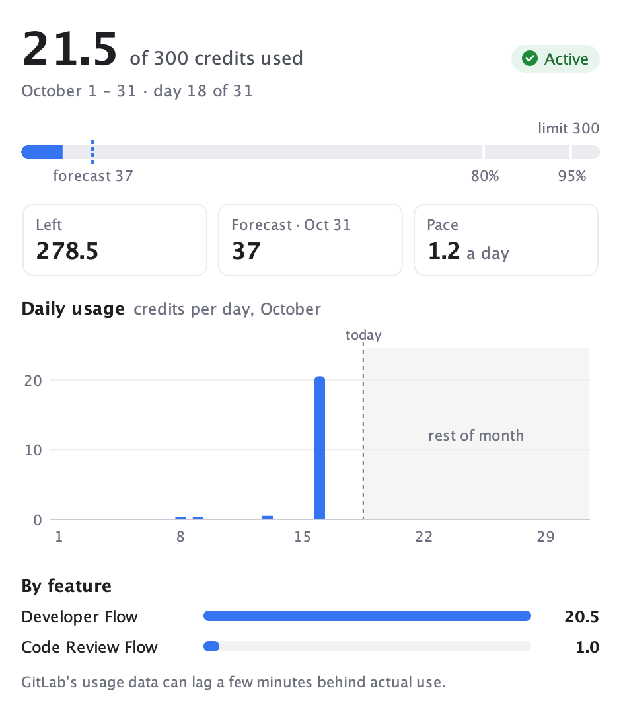
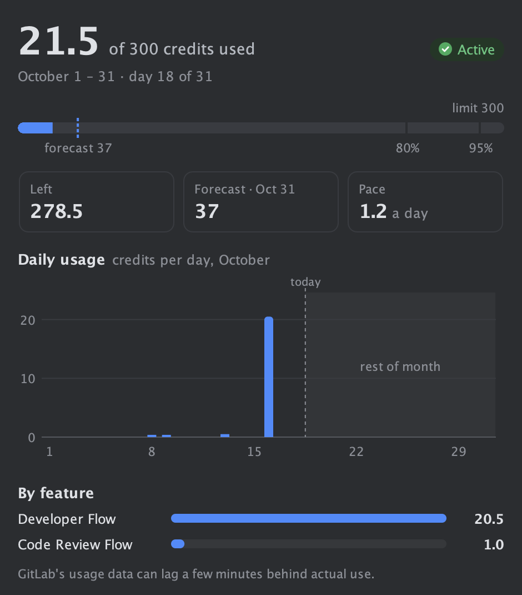
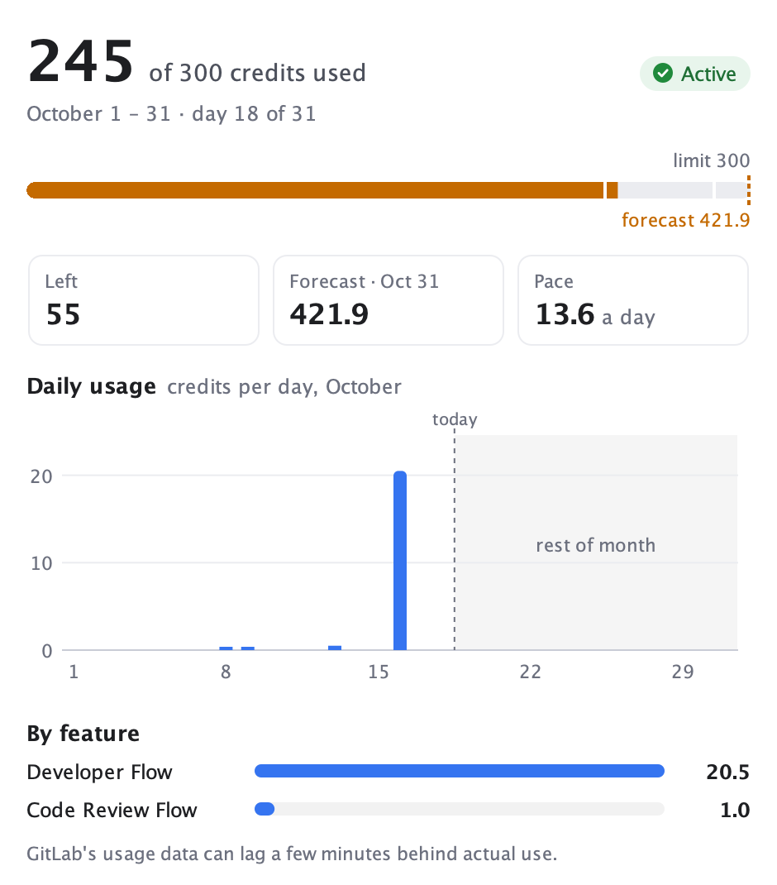

<div align="center">

<picture>
  <source media="(prefers-color-scheme: dark)" srcset="docs/images/logo-dark.svg">
  
</picture>

# Duo Watchdog

**Keep an eye on your GitLab Duo credits without leaving the IDE.**

An IntelliJ Platform plugin that tracks **your own** GitLab Credits usage for the current billing period,
forecasts where the month will end, and warns you before you hit your limit.


</div>

<p align="center">
  
  &nbsp;&nbsp;
  
</p>

---

## Contents

- [Features](#features)
- [How it works](#how-it-works)
- [Installation](#installation)
- [Configuration](#configuration)
- [Building from source](#building-from-source)
- [Project structure](#project-structure)
- [Troubleshooting](#troubleshooting)

## Features

### Status bar meter

The status bar shows a doberman icon, a small meter and `$21.5 / 300`: credits used out of your limit
(GitLab's list price is $1 per credit).

- **Normal:** neutral colors while usage is below your lowest alert threshold.
- **Warning:** amber with a warning icon once usage reaches the lowest threshold.
- **Blocked:** red `Blocked · $300 / 300` when GitLab blocks Duo because you hit the cap.

The tooltip shows the remaining credits, the month-end forecast and when the data was last updated.
Clicking the meter opens the dashboard.

### Dashboard tool window



- A toolbar with **Refresh** and **Settings**, plus `@user · group · Updated HH:mm`
- The headline: credits used, an **Active** / **Blocked** status and the period with the current day
- A usage bar with a dashed forecast marker and ticks at each alert threshold
- Tiles for **Left**, **Forecast** and **Pace** (credits per day)
- A **daily usage** chart covering the whole month, with the rest of the month shaded, a "today" line and tooltips on the bars
- A **by feature** breakdown (Developer Flow, Code Review Flow, …)

<br clear="right">

### Alerts

Balloon notifications with an **Open Duo Watchdog** link. Each one fires **at most once per billing period**:

| Alert | When it fires |
|---|---|
| Forecast | the month-end forecast goes over your limit (you can turn this one off) |
| Threshold | usage reaches each configured percentage of the limit (default `80, 95`) |
| Limit reached | usage reaches 100% of the limit |
| Blocked | GitLab has blocked Duo because of the cap |

## How it works

Duo Watchdog queries GitLab's GraphQL API for
`currentUser.creditsUsage(namespacePath:)`, which returns the spend of the user who owns the token.
You only need to be a **member** of the top-level group; the **Owner** role is not required.

> [!NOTE]
> GitLab marks `creditsUsage` as an **Experiment** (available since GitLab 19.4), so its shape may change.

**Forecast** is a straight run-rate projection to the end of the billing period:

```
forecast = used / elapsed_days × period_days
```

**You set the limit.** GitLab shows a user's cap only to group owners, so the plugin can't read it.
Enter your cap, or a smaller budget of your own.

Requests go through the IDE's proxy and trusted certificates
(*Settings → Appearance & Behavior → System Settings → HTTP Proxy / Server Certificates*).

## Installation

1. [Build the plugin](#building-from-source), or get `duo-watchdog-<version>.zip` from a teammate.
2. In the IDE, open *Settings → Plugins → ⚙ → Install Plugin from Disk…*
3. Select `build/distributions/duo-watchdog-0.2.1.zip` and restart if the IDE asks you to.

**Compatibility:** IntelliJ IDEA and any other JetBrains IDE from **2024.3** onward. This holds whichever IDE version the plugin was built against.

## Configuration

Open *Settings → Tools → Duo Watchdog*.

| Setting | What to enter |
|---|---|
| **GitLab URL** | `https://gitlab.com` or the address of your self-managed GitLab |
| **Group path** | The path of the top-level group that owns the Duo subscription, e.g. `my-company`. **Find my group** goes through your groups and asks GitLab which one holds your credits. Pasting the group's URL also works; the plugin keeps only the path. |
| **Personal access token** | A token with the **`read_api`** and **`ai_features`** scopes and nothing more. The *Create the token in GitLab* link opens GitLab's new-token page with both scopes already selected. The token is stored in the IDE's **Password Safe**, not in plain settings. |
| **Limit (credits)** | Your limit. Default: `100` |
| **Alert at % of limit** | Comma-separated thresholds, e.g. `50, 80, 95` |
| **Alert when the month-end forecast passes the limit** | Turns the forecast alert on or off |
| **Refresh every … minutes** | Polling interval. Default: `15`. GitLab's data can lag a few minutes behind actual use. |

## Building from source

**Requirements:** JDK 17+ to run Gradle. Gradle downloads the compile JDK itself: 21, or 25 when building
against IDEA 2026.2 or later. The plugin's classes target Java 21 in both cases.

```bash
./gradlew :core:test      # unit tests for the core logic (no IDE needed)
./gradlew buildPlugin     # → build/distributions/duo-watchdog-0.2.1.zip
./gradlew runIde          # launch a sandbox IDE with the plugin installed
```

### Which IDE it compiles against

The build compiles against an IntelliJ IDEA **already installed** on your machine. It looks in the usual places
(`/Applications`, `~/Applications`, `C:/Program Files/JetBrains`, `%LOCALAPPDATA%/Programs`, `/opt`, and Toolbox on Linux)
and logs which IDE it picked. To choose one yourself:

```bash
./gradlew buildPlugin -PideaPath="/path/to/IntelliJ IDEA.app"
# or
export IDEA_HOME="/path/to/IntelliJ IDEA.app"
```

Gradle downloads IntelliJ IDEA 2024.3 (~1 GB, cached after the first run) only when it finds no installed IDEA.

## Project structure

```
duo-watchdog/
├── core/                 Plain Java, no IntelliJ dependencies
│   ├── src/main/…/core/  GraphQL client, billing period & forecast, alert rules, texts
│   ├── src/main/…/ui/    Pure Swing components: dashboard, meter, chart, feature bars, status chip
│   └── src/test/         JUnit 5 tests; also paints the UI headless to core/build/ui-previews/*.png
└── src/                  Thin IntelliJ layer: settings, refresh service, status bar widget,
                          tool window, notifications
```

The UI components get their colors from the plugin as light/dark pairs, so they follow the IDE theme.
Running `./gradlew :core:test` also renders every dashboard state to PNG. You can review UI changes from those images without starting an IDE.

## Troubleshooting

<details>
<summary><b>"resource … does not exist or you don't have permission"</b></summary>

The **Group path** field most likely holds the group's display *name* instead of its *path* (the part after
`gitlab.com/` in the URL). Click **Find my group** in the settings and the plugin will find the right path.
</details>

<details>
<summary><b>The numbers are behind what I just used</b></summary>

GitLab's usage data can lag a few minutes behind actual use. Click **Refresh** in the tool window, or use
*Tools → Refresh Duo Credits*, to fetch again now.
</details>

<details>
<summary><b>Requests time out behind a corporate proxy</b></summary>

Duo Watchdog uses the IDE's own HTTP proxy and certificate settings. Check
*Settings → Appearance & Behavior → System Settings → HTTP Proxy* and *Server Certificates*.
</details>

<details>
<summary><b>The plugin doesn't show my cap</b></summary>

That's expected: GitLab shows a user's cap only to group owners. Enter your limit in the settings.
</details>
